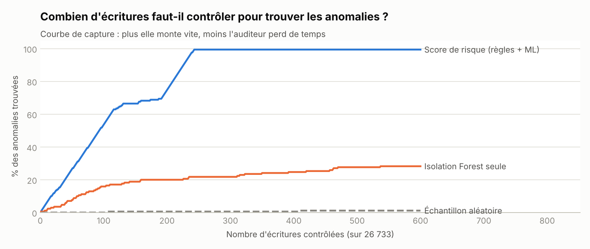
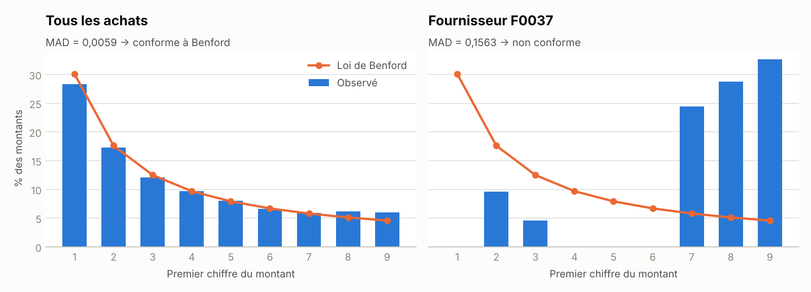

# Audit analytique des écritures comptables (FEC)


> **Rapport en ligne : https://ismaildataa.github.io/audit-fec-anomalies/**

Outil qui lit un **FEC** (Fichier des Écritures Comptables, format imposé par l'administration fiscale
à toute entreprise française), contrôle sa conformité, applique des **tests d'audit**, la **loi de
Benford** et un modèle d'**Isolation Forest**, puis classe chaque écriture par niveau de risque pour
produire un **échantillon de contrôle ciblé** au format Excel.

## Pourquoi ce projet

Un exercice comptable de PME représente des dizaines de milliers d'écritures. Un auditeur ou un
contrôleur de gestion ne peut en vérifier qu'une petite partie : s'il les choisit au hasard, il passe à
côté de presque toutes les anomalies. L'objectif est de lui dire **où regarder en premier**.

## Résultat principal

Sur un exercice fictif de **26 733 écritures** (67 724 lignes) contenant 170 anomalies injectées :

| | Score de risque (règles + ML) | Isolation Forest seule | Échantillon aléatoire |
|---|---|---|---|
| Vraies anomalies dans le top 100 | **92 %** | 27 % | ~2 % |
| Anomalies trouvées en contrôlant 300 écritures (1,1 %) | **99,4 %** | — | 0,6 % |



**Lecture honnête de ces chiffres.** Les anomalies sont injectées dans des données synthétiques, donc
plus « propres » que dans la réalité. Ce qui compte, c'est la comparaison : à effort égal, l'échantillon
ciblé trouve plus de 150 fois plus d'anomalies que l'échantillon aléatoire, et l'association règles
métier + machine learning fait beaucoup mieux que le ML seul. Certains tests (fractionnement, montant
atypique) signalent aussi des écritures légitimes : c'est normal, la décision finale reste au contrôleur.

## Ce que fait l'outil

1. **Conformité du fichier** — 18 colonnes réglementaires, champs obligatoires, équilibre de chaque
   écriture et de la balance, numérotation chronologique par journal, cohérence des dates.
2. **7 tests d'audit pondérés**

   | Test | Ce qu'il cherche | Poids |
   |---|---|---|
   | Déséquilibre | Débit ≠ crédit dans une écriture | 5 |
   | Doublon | Même fournisseur, même pièce, même montant | 5 |
   | Fractionnement | Plusieurs factures juste sous le seuil de double validation (5 000 €) en quelques jours | 4 |
   | Montant atypique | Z-score robuste (médiane / MAD) du montant par rapport à l'historique du fournisseur | 4 |
   | Validation tardive | Écriture validée plus de 60 jours après sa date (antidatage) | 3 |
   | OD à montant rond | Opération diverse manuelle de 1 000 €, 5 000 €… | 3 |
   | Jour non ouvré | Week-end ou jour férié (calcul automatique de Pâques, Ascension, Pentecôte) | 2 |

3. **Loi de Benford** — conformité globale des montants d'achats (indicateur MAD de Nigrini) et
   **analyse de contribution** : quel fournisseur dégrade le plus la conformité ? Sur la démo, le
   fournisseur aux montants fabriqués ressort en n°1.
4. **Isolation Forest** — détecte les écritures au profil inhabituel sans règle écrite à l'avance
   (montant, délai de validation, jour, écart au comportement du tiers…).
5. **Score de risque** = somme des poids des tests déclenchés + 3 × score Isolation Forest.



## Démarrage rapide

```bash
git clone https://github.com/ismaildataa/audit-fec-anomalies.git
cd audit-fec-anomalies
pip install -r requirements.txt

python run_audit.py                    # génère un FEC de démonstration et l'audite (~6 s)
python run_audit.py --fec MON_FEC.txt  # audite un vrai FEC exporté du logiciel comptable
pytest -q                              # 11 tests
```

Sorties : `docs/index.html` (rapport), `outputs/echantillon_a_controler.xlsx` (300 écritures
prioritaires avec leurs motifs, tests, conformité, Benford).

Le lecteur accepte les séparateurs tabulation et `|`, et les décimales à la virgule comme au point :
il fonctionne avec les exports des principaux logiciels comptables.

## Choix techniques

- **Données** : générateur d'un exercice complet d'une PME fictive (achats, ventes, banque, paie)
  au format DGFiP exact. Chaque anomalie injectée est tracée pour mesurer la détection.
- **Renumérotation chronologique** après injection : les écritures anormales ne se trahissent pas par
  leur numéro, sinon le test serait biaisé.
- **Z-score robuste** plutôt que moyenne / écart-type : une seule facture énorme ne fausse pas la
  référence du fournisseur.
- **Benford par contribution** plutôt que par fournisseur isolé : sur une centaine de factures, un
  fournisseur sain peut s'écarter de Benford par simple hasard ; mesurer son impact sur l'ensemble est
  plus robuste.

## Structure

```
├── run_audit.py              # point d'entrée
├── src/fec_audit/
│   ├── generate_fec.py       # FEC fictif + anomalies tracées
│   ├── fec_io.py             # lecture d'un FEC et contrôles de conformité
│   ├── calendar_fr.py        # jours fériés français
│   ├── controls.py           # 7 tests d'audit
│   ├── benford.py            # loi de Benford, MAD
│   ├── scoring.py            # Isolation Forest + score de risque
│   └── charts.py
├── templates/report.html.j2
└── tests/
```

---

**Ismail Yahyaoui** — Data Analyst · Master Mathématiques appliquées & Statistiques ·
[Portfolio](https://ismaildataa.github.io) · [LinkedIn](https://www.linkedin.com/in/ismail-yahyaoui-data-analyst/)
